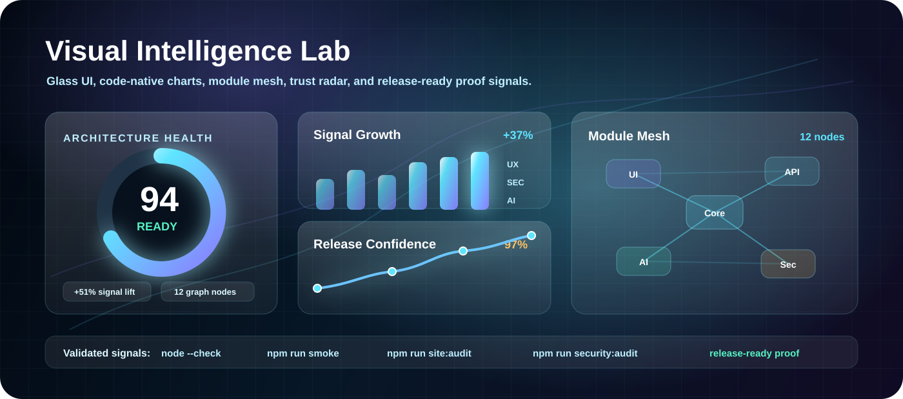
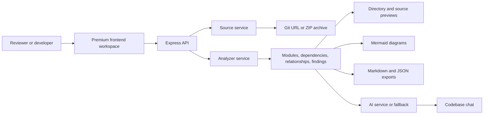

<p align="center">
  
</p>

<h1 align="center">LumenStack AI</h1>

<p align="center">
  <strong>A repository learning workspace that turns unfamiliar code into source-linked understanding and recruiter-ready walkthroughs.</strong>
</p>

<p align="center">
  <a href="https://lumenstack-ai.onrender.com/"><strong>Live Product</strong></a>
  &nbsp;&nbsp;|&nbsp;&nbsp;
  <a href="https://github.com/agarwalujala3-lang/LumenStack-AI/actions/workflows/smoke.yml"><strong>CI Quality Gate</strong></a>
  &nbsp;&nbsp;|&nbsp;&nbsp;
  <a href="https://lumenstack-ai.onrender.com/case-study.html"><strong>Case Study</strong></a>
  &nbsp;&nbsp;|&nbsp;&nbsp;
  <a href="https://www.linkedin.com/in/ujala-agarwal-30aa28283/"><strong>LinkedIn</strong></a>
</p>

<p align="center">
  <a href="https://github.com/agarwalujala3-lang/LumenStack-AI/actions/workflows/smoke.yml"></a>
  
  
  
  
  
</p>

<p align="center">
  
</p>

---

## What It Is

**LumenStack AI helps anyone get oriented in an unfamiliar repository.** Analyze a Git repository or ZIP, follow a plain-language, source-linked learning path, inspect the actual files behind an explanation, compare versions, ask grounded questions, and prepare a recruiter-ready walkthrough. The guide distinguishes observed facts from analyzer inferences and does not claim that a static scan proves runtime behavior.

The project is built to demonstrate both product taste and engineering depth: a premium frontend, a real Express analysis backend, meaningful security checks, CI governance, and documentation that helps a reviewer see the complete system quickly.

## Product At A Glance

<table>
  <tr>
    <td><strong>Analyze</strong></td>
    <td>Read repositories, ZIP uploads, modules, dependencies, entrypoints, language mix, and platform signals.</td>
  </tr>
  <tr>
    <td><strong>Explain</strong></td>
    <td>Generate architecture summaries with OpenAI when configured, plus deterministic fallback output when no key is present.</td>
  </tr>
  <tr>
    <td><strong>Visualize</strong></td>
    <td>Create focused Mermaid architecture, import-flow, class, and manifest-package diagrams with a plain-language note about each map.</td>
  </tr>
  <tr>
    <td><strong>Explore</strong></td>
    <td>Open a VS Code-inspired, read-only workspace with a searchable directory tree, source previews, entrypoints, and module context.</td>
  </tr>
  <tr>
    <td><strong>Learn</strong></td>
    <td>Follow a progressive beginner walkthrough with evidence-linked recall checks, inspect detected build/test/deploy settings, explore reverse-import change impact, and rehearse recruiter answers with a private local rubric.</td>
  </tr>
  <tr>
    <td><strong>Review</strong></td>
    <td>Use compare mode, quality scores, hotspots, risk findings, platform radar, and chat to guide technical decisions.</td>
  </tr>
  <tr>
    <td><strong>Export</strong></td>
    <td>Download Markdown or JSON reports for reviewers, teammates, hiring panels, or release discussions.</td>
  </tr>
</table>

## Product Surfaces

The interface centers the repository workflow and keeps one saved theme preference across its pages.

| Surface | Role |
| --- | --- |
| **Analysis overview** | Summary, stack signals, quality review, and compare findings grouped into readable views. |
| **Learn &amp; present** | Progressive source-linked learning, quick knowledge checks, a code-to-deploy map, reverse-import impact exploration, technology-fit explanations, and a timed interview lab whose draft stays in the browser. |
| **Repository explorer** | Searchable directory tree, source previews, entrypoints, generated summary, and module context. |
| **Architecture maps** | Mermaid diagrams with bounded node counts, safer labels, and captions that describe inferred links. |
| **Quick guide** | Four visual steps connect repository intake to understanding, source exploration, and presentation. |
| **Theme system** | Translucent midnight-blue surfaces, cyan and multicolor signal accents, and a persistent light/dark toggle. |

## System Flow

<p align="center">
  
</p>



## Engineering Highlights

| Area | Implementation |
| --- | --- |
| **Backend** | Express app with analysis, session-bound source previews, chat, export, platform catalog, demo auth, saved project, and webhook routes. |
| **Analysis engine** | Language detection, module grouping, dependency parsing, relationship extraction, hotspot ranking, and quality scoring. |
| **Learning guide** | Beginner-first explanations, staged recall checks, inferred code-reading path, detected runtime/CI/deployment configuration, reverse-import impact estimates, cautious technology rationale, and a private recruiter-practice rubric derived from indexed source evidence. |
| **Change impact** | Baseline comparison with changed, added, and removed code paths plus the modules touched; it does not claim runtime verification. |
| **Source handling** | Public Git URLs, generic HTTPS remotes, provider-aware workspace flows, and ZIP archive uploads. The explorer only serves indexed text from the selected analysis session. |
| **AI layer** | OpenAI integration with safe fallback summaries so the app still works without secrets. |
| **Frontend** | HTML, CSS, vanilla JavaScript, persistent theme preference, focused analysis tabs, source explorer, and a step-by-step guide. |
| **Governance** | GitHub Actions, Dependabot, issue templates, PR template, security policy, contribution guide, and audit scripts. |

## Repository Structure

| Path | Purpose |
| --- | --- |
| [`src/app.js`](src/app.js) | Express app, security headers, routes, exports, demo APIs, and static serving. |
| [`src/services/analyzerService.js`](src/services/analyzerService.js) | Core repository intelligence engine. |
| [`src/services/learningGuideService.js`](src/services/learningGuideService.js) | Builds the evidence-linked learning path and recruiter talk track. |
| [`src/services/sourceService.js`](src/services/sourceService.js) | Git and ZIP source preparation. |
| [`src/services/aiService.js`](src/services/aiService.js) | OpenAI and fallback explanation flow. |
| [`src/services/chatService.js`](src/services/chatService.js) | Grounded chat over analysis sessions. |
| [`public/index.html`](public/index.html) | Primary product experience and live analyzer surface. |
| [`public/explorer.html`](public/explorer.html) | Searchable repository tree and read-only source preview workspace. |
| [`public/guide.html`](public/guide.html) | Visual walkthrough from source intake to shareable findings. |
| [`public/experience.css`](public/experience.css) | Shared theme tokens, focused layouts, explorer, and guide styling. |
| [`public/styles.css`](public/styles.css) | Main visual system, layout, responsive rules, and glass UI layer. |
| [`public/site-actions.js`](public/site-actions.js) | UI actions, sharing, exports, use cases, and visual mode switching. |
| [`scripts/site-audit.js`](scripts/site-audit.js) | Static page, asset, and handled-button audit. |
| [`.github/workflows/smoke.yml`](.github/workflows/smoke.yml) | CI quality gate. |

## Quality Proof

| Check | Command | What it protects |
| --- | --- | --- |
| JavaScript syntax | `node --check public/site-actions.js` | Frontend interaction code parses cleanly. |
| Product behavior | `npm test` | Learning evidence, source-line import links, and change-impact details remain correct. |
| Smoke test | `npm run smoke` | Analyzer works against this repository. |
| Site audit | `npm run site:audit` | Static pages, assets, and button handlers are valid. |
| Security audit | `npm run security:audit` | Security hardening expectations remain intact. |
| Diff hygiene | `git diff --check` | Whitespace and patch issues are caught before commit. |

## Tech Stack

| Layer | Technology |
| --- | --- |
| Runtime | Node.js 20+ |
| API | Express |
| Upload handling | Multer |
| Archive parsing | adm-zip |
| AI | OpenAI API with fallback summaries |
| Diagrams | Mermaid |
| Frontend | HTML, CSS, vanilla JavaScript |
| Visual layer | SVG assets, generated product imagery, CSS motion, tsParticles |
| CI and governance | GitHub Actions, Dependabot, templates, audits |
| Deployment | Render web service |

## Run Locally

```bash
npm install
cp .env.example .env
npm start
```

Windows PowerShell:

```powershell
npm install
Copy-Item .env.example .env
npm start
```

Open:

```text
http://localhost:3000
```

The app works without an OpenAI key. Add `OPENAI_API_KEY` to enable live AI explanations and chat.

## Environment

```env
OPENAI_API_KEY=
OPENAI_MODEL=gpt-5-mini
GITHUB_WEBHOOK_SECRET=
PORT=3000
```

| Variable | Required | Purpose |
| --- | --- | --- |
| `OPENAI_API_KEY` | No | Enables live AI explanations and codebase chat. |
| `OPENAI_MODEL` | No | Selects the model for live AI mode. |
| `GITHUB_WEBHOOK_SECRET` | No | Optional webhook signature secret. |
| `PORT` | No | Local server port. Render sets this in production. |

## API Surface

| Method | Route | Purpose |
| --- | --- | --- |
| `GET` | `/health` | Health check. |
| `GET` | `/api/platforms` | Supported provider catalog. |
| `POST` | `/api/auth/demo` | Demo recruiter sign-in. |
| `GET` | `/api/projects` | List saved demo projects. |
| `POST` | `/api/projects` | Save a demo architecture project. |
| `POST` | `/api/analyze` | Analyze a repository or uploaded ZIP. |
| `GET` | `/api/analysis/:analysisId` | Read the session summary and indexed repository tree. |
| `GET` | `/api/analysis/:analysisId/file?path=...` | Read one previewable file from that analysis session. |
| `POST` | `/api/chat` | Ask questions against an analysis session. |
| `POST` | `/api/system-chat` | Ask product or system-level questions. |
| `GET` | `/api/export/:analysisId` | Export Markdown or JSON. |
| `POST` | `/api/github/webhook` | Store webhook-triggered reports. |

## Deployment

```text
Build command: npm install
Start command: npm start
Node version: 20+
```

Live product:

```text
https://lumenstack-ai.onrender.com/
```

Health check:

```text
https://lumenstack-ai.onrender.com/health
```

## Fast Review Path

1. Open the live product.
2. Run a public repository URL or upload a ZIP.
3. Read the generated summary and inspect the overview signals.
4. Open the architecture view, then follow a module into the repository explorer.
5. Use the [four-step guide](https://lumenstack-ai.onrender.com/guide.html) to prepare a walkthrough.
6. Ask a codebase question or export the Markdown and JSON brief.

Analysis sessions expire after two hours. Source previews are served by an exact path lookup in the selected session; JSON exports contain analysis metadata rather than indexed source contents.

## Roadmap

- Persistent saved projects with PostgreSQL, Supabase, or Neon.
- Authenticated private repository workspaces.
- Pull request review summaries and GitHub comment automation.
- Dependency risk enrichment with registry metadata.
- Historical quality trends across saved analyses.
- Team dashboard for architecture review workflows.

## Author

Built by **Ujala Agarwal**.

- Live Project: <https://lumenstack-ai.onrender.com/>
- LinkedIn: <https://www.linkedin.com/in/ujala-agarwal-30aa28283/>
- GitHub: <https://github.com/agarwalujala3-lang>
- Email: <agarwalujala3@gmail.com>

## License

MIT. See [`LICENSE`](LICENSE).
