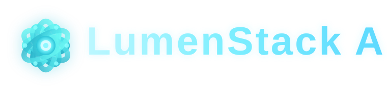
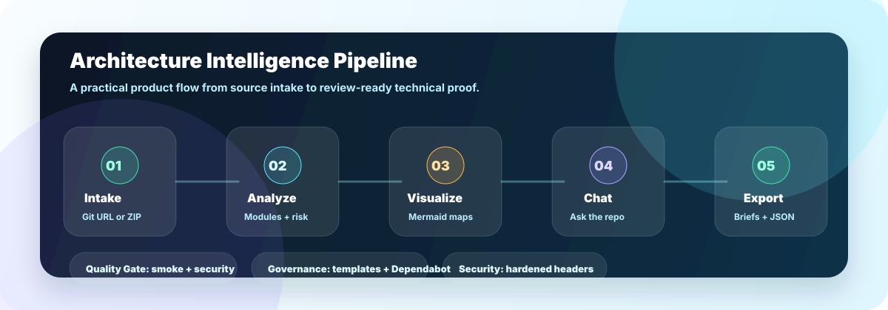
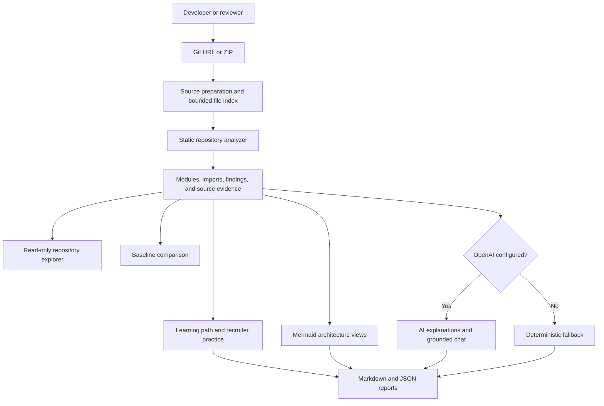

<p align="center">
  
</p>

<h1 align="center">LumenStack AI</h1>

<p align="center">
  <strong>Turn an unfamiliar repository into a system you can explain, trace, and defend.</strong>
</p>

<p align="center">
  <a href="https://lumenstack-ai.onrender.com/"><strong>OPEN THE LIVE WORKSPACE</strong></a>
  &nbsp; | &nbsp;
  <a href="https://lumenstack-ai.onrender.com/case-study.html">Read the case study</a>
  &nbsp; | &nbsp;
  <a href="https://lumenstack-ai.onrender.com/guide.html">Take the visual tour</a>
  &nbsp; | &nbsp;
  <a href="#recruiter-demo">Start here</a>
</p>

<p align="center">
  <a href="https://github.com/agarwalujala3-lang/LumenStack-AI/actions/workflows/smoke.yml"></a>
  
  
  
  <a href="LICENSE"></a>
</p>

<p align="center">
  
</p>

> **The idea:** don’t just summarize a codebase. Give people a trustworthy path through it, show the files behind the explanation, and help them describe what they learned in their own words.

<details>
  <summary><strong>Jump to a path</strong></summary>

  <p>
    <a href="#recruiter-demo">Recruiter demo</a> &middot;
    <a href="#what-you-can-do">Product tour</a> &middot;
    <a href="#how-the-system-works">System design</a> &middot;
    <a href="#engineering-choices">Engineering choices</a> &middot;
    <a href="#run-it-locally">Run locally</a> &middot;
    <a href="#quality-and-security">Quality and security</a> &middot;
    <a href="#next-steps">Next steps</a>
  </p>
</details>

## Recruiter Demo

### A three-minute walkthrough

1. **[Open LumenStack AI](https://lumenstack-ai.onrender.com/)** and choose **Explore sample repo**. The bundled Atlas Catalog API loads without an OpenAI key or an external AI request.
2. Open **Learn & present** and start the short guided tour. Follow the links from each explanation to the exact source lines that support it.
3. Open the **Repository** workspace to browse the sample tree and inspect files in a read-only, editor-style view.
4. Switch to **Architecture** to inspect the generated maps. Return to the learning guide to see its evidence labels and practice an explanation.

<details>
  <summary><strong>What this walkthrough demonstrates</strong></summary>

  <ul>
    <li>A usable product path for someone who has never seen the repository.</li>
    <li>Source-linked explanations rather than unsupported architecture claims.</li>
    <li>A frontend and Express backend connected through working analysis APIs.</li>
    <li>An AI-optional product that still provides a useful deterministic sample.</li>
    <li>A recruiter practice flow that encourages accurate ownership claims.</li>
  </ul>
</details>

## The Problem It Solves

Starting in a large or unfamiliar repository can mean bouncing between folders, manifests, diagrams, and documentation without knowing what to trust. LumenStack AI turns that first exploration into a guided workflow:

**Bring a repository -> see its structure -> follow evidence -> understand the workflow -> explain the project.**

The learning guide distinguishes indexed evidence from structural inference. It does not present a static scan as proof that the application runs, a test passes, or a deployment is healthy.

## What You Can Do

<details open>
  <summary><strong>Repository analysis and review</strong></summary>

  Analyze a supported Git URL or ZIP archive. Explore language and framework signals, entrypoint candidates, modules, local imports, quality findings, hotspots, and platform configuration. Compare two snapshots to see changed files and affected areas.
</details>

<details>
  <summary><strong>Visual architecture and source exploration</strong></summary>

  Switch between focused Mermaid views for architecture, import flow, classes, and manifests. Open the repository explorer for a searchable directory tree, source previews, and links back to cited files. The explorer is read-only and serves indexed text from the selected analysis session.
</details>

<details>
  <summary><strong>Learn it, then present it</strong></summary>

  Follow a progressive learning path, test your understanding with quick recall, inspect workflow and infrastructure evidence, explore reverse-import impact, review technology-fit explanations, and practice interview questions. Contribution notes stay in this browser; they are not sent to the server.
</details>

<details>
  <summary><strong>Grounded chat and portable reports</strong></summary>

  Ask questions about the analyzed repository and export Markdown or JSON briefs. When an OpenAI key is not configured, the application uses a deterministic fallback where available and labels the analysis accordingly.
</details>

### Evidence, made visible

| Label | Meaning |
| --- | --- |
| **Observed** | A supported signal was found in indexed source, documentation, or configuration. |
| **Inferred** | The analyzer found a likely structural interpretation; verify it against the repository. |
| **Not found** | The scan did not detect the signal. This is not proof that it does not exist. |
| **Not verified** | Static analysis cannot establish runtime behavior, test results, or deployment health. |

## How the System Works



### Request lifecycle

1. The Express API validates a source request and prepares a Git checkout or ZIP archive.
2. The analyzer indexes supported files and extracts static signals. It does not execute repository code.
3. The learning guide connects findings to file and line evidence, while marking inference and unknowns.
4. The UI renders focused views, source previews, comparison results, and optional AI assistance.
5. A short-lived analysis session backs source links and Markdown or JSON exports.

## Engineering Choices

| Choice | Why it fits this product | Trade-off kept visible |
| --- | --- | --- |
| **Node.js + Express** | One runtime for the web API, file processing, analysis orchestration, and deployment. | Static analysis is not a substitute for executing or testing a target project. |
| **Purpose-built analyzer services** | Keep source intake, analysis, learning, chat, and comparison responsibilities separable. | Heuristics can miss dynamic imports, generated code, or runtime-only behavior. |
| **Mermaid** | Render architecture and relationship views from analysis results without maintaining separate diagram images for each repository. | A map is a navigation aid; it is not a complete runtime trace. |
| **Optional OpenAI integration** | Add natural-language explanations while keeping a deterministic path available without a key. | When enabled, analysis context is sent to the configured AI provider. Only analyze content you are authorized to share. |
| **Browser-local study notes** | Let a learner prepare their own talk track without creating an account or sending notes to the server. | Notes are local to that browser and are not synced or backed up. |
| **Render + GitHub Actions** | Keep deployment and regression checks straightforward for a small full-stack product. | A passing CI run does not, by itself, prove production health. |

These are product-fit explanations, not claims about undocumented historical decisions.

## Repository Map

```text
.
├── public/
│   ├── index.html                 # Analysis workspace
│   ├── explorer.html              # Searchable, read-only source explorer
│   ├── guide.html                 # Visual getting-started guide
│   ├── app.js                     # Analysis UI and learning interactions
│   ├── experience.css             # Product theme, explorer, and guide styles
│   └── readme-architecture-flow.svg
├── src/
│   ├── app.js                     # Express routes and security headers
│   └── services/
│       ├── analyzerService.js     # Static codebase analysis
│       ├── sourceService.js       # Git and ZIP intake
│       ├── learningGuideService.js# Evidence-linked learning material
│       ├── aiService.js           # Optional AI and deterministic fallback
│       ├── chatService.js         # Repository-grounded chat
│       └── comparisonService.js   # Baseline comparison
├── test/                          # Product and analyzer regression tests
├── scripts/                       # Smoke, site, and security audits
└── .lumenstack-demo-repo/          # Compact, AI-free guided sample
```

## Run It Locally

**Requirements:** Node.js 20 or later.

```bash
npm ci
cp .env.example .env
npm start
```

On Windows PowerShell:

```powershell
npm ci
Copy-Item .env.example .env
npm start
```

Then open **http://localhost:3000**. The sample and deterministic analysis work without an AI key. To enable AI explanations and chat, add a valid key to `.env`:

```env
OPENAI_API_KEY=your-key
OPENAI_MODEL=gpt-5-mini
PORT=3000
```

Never commit `.env` or paste credentials into an issue, README, repository URL, or sample project.

## Quality and Security

```bash
npm test
npm run site:audit
npm run smoke
npm run security:audit
```

The GitHub Actions quality gate runs the product tests, site audit, smoke analysis, and security audit on pushes to `main` and pull requests.

**Important boundaries:**

- The analyzer reads supported files; it does not run code from an analyzed repository.
- ZIP upload size is limited by the API. Treat repository archives as untrusted input and submit only material you have permission to analyze.
- When AI is enabled, selected repository context is sent to the configured AI provider for explanations or chat.
- Analysis sessions are temporary. Do not use browser-local notes for secrets or sensitive data.
- Demo sign-in and saved-project endpoints are demonstration features, not production identity or access control.

## API Surface

| Method | Endpoint | Purpose |
| --- | --- | --- |
| `GET` | `/health` | Service health response. |
| `GET` | `/api/platforms` | Supported source platform catalog. |
| `POST` | `/api/demo-analysis` | Load the bundled sample without external AI. |
| `POST` | `/api/analyze` | Analyze a Git source or uploaded ZIP. |
| `GET` | `/api/analysis/:analysisId` | Read the analysis summary and indexed tree. |
| `GET` | `/api/analysis/:analysisId/file?path=...` | Preview one indexed file. |
| `POST` | `/api/chat` | Ask a question about an analysis. |
| `POST` | `/api/system-chat` | Ask a product-level question. |
| `GET` | `/api/export/:analysisId` | Export a Markdown or JSON report. |
| `POST` | `/api/github/webhook` | Accept a configured GitHub webhook report. |

The demo auth and saved-project routes are intentionally omitted from this product API list because they are not production identity features.

## Deployment

The Render blueprint uses `npm install` for the build, `npm start` for the service, and `/health` as its health check. GitHub Actions provides the repository quality gate.

- **Live app:** [lumenstack-ai.onrender.com](https://lumenstack-ai.onrender.com/)
- **Health:** [lumenstack-ai.onrender.com/health](https://lumenstack-ai.onrender.com/health)
- **CI runs:** [GitHub Actions](https://github.com/agarwalujala3-lang/LumenStack-AI/actions)
- **Architecture case study:** [Open case study](https://lumenstack-ai.onrender.com/case-study.html)

## Next Steps

The most valuable next improvements are about stronger evidence and safer team workflows, not more decorative panels:

1. **Runtime evidence:** optionally ingest test output or CI artifacts, so static findings can be compared with verified execution results.
2. **Dependency intelligence:** add version-aware vulnerability data with clear source links, timestamps, and confidence labels.
3. **Pull-request learning mode:** compare a branch or pull request and explain changed code, affected modules, and verification steps together.
4. **Private-repository support:** design authentication, secret handling, retention, and access controls before adding private source ingestion.
5. **Accessibility and performance budgets:** continuously test keyboard navigation, reduced motion, contrast, mobile layout, and analysis limits in CI.

## Project Links

- **Live product:** https://lumenstack-ai.onrender.com/
- **Source:** https://github.com/agarwalujala3-lang/LumenStack-AI
- **Maintainer:** [Ujala Agarwal](https://www.linkedin.com/in/ujala-agarwal-30aa28283/)
- **License:** [MIT](LICENSE)

---

<p align="center"><strong>Understand the code. Follow the evidence. Tell the story accurately.</strong></p>
